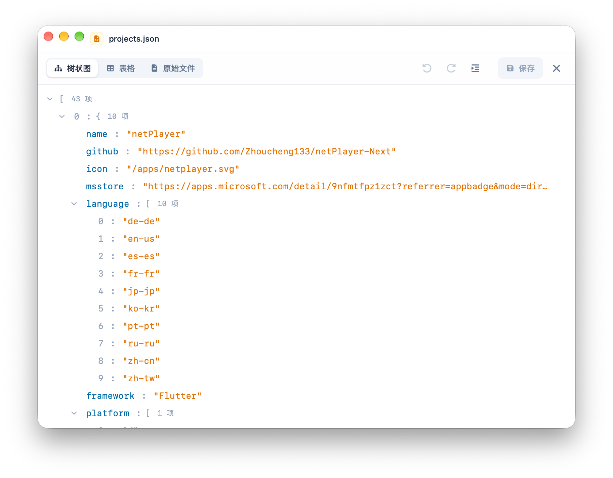
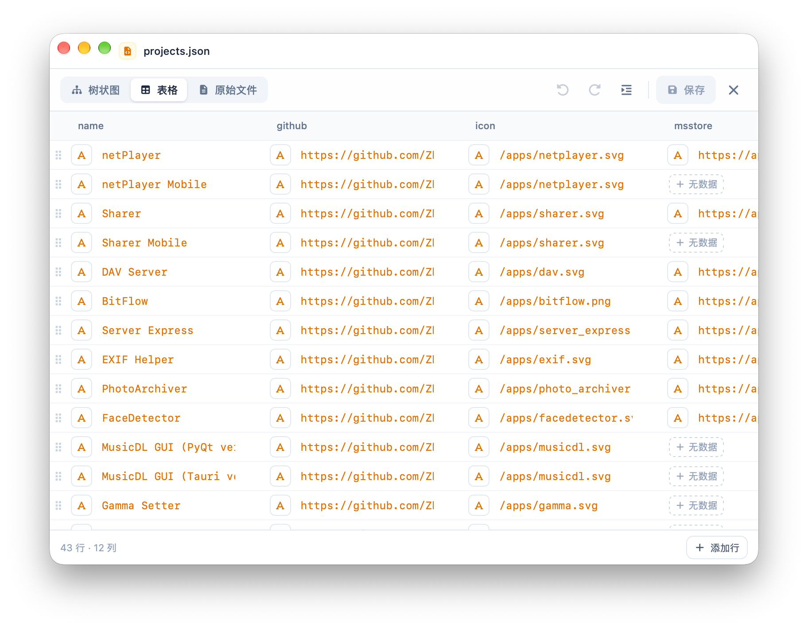
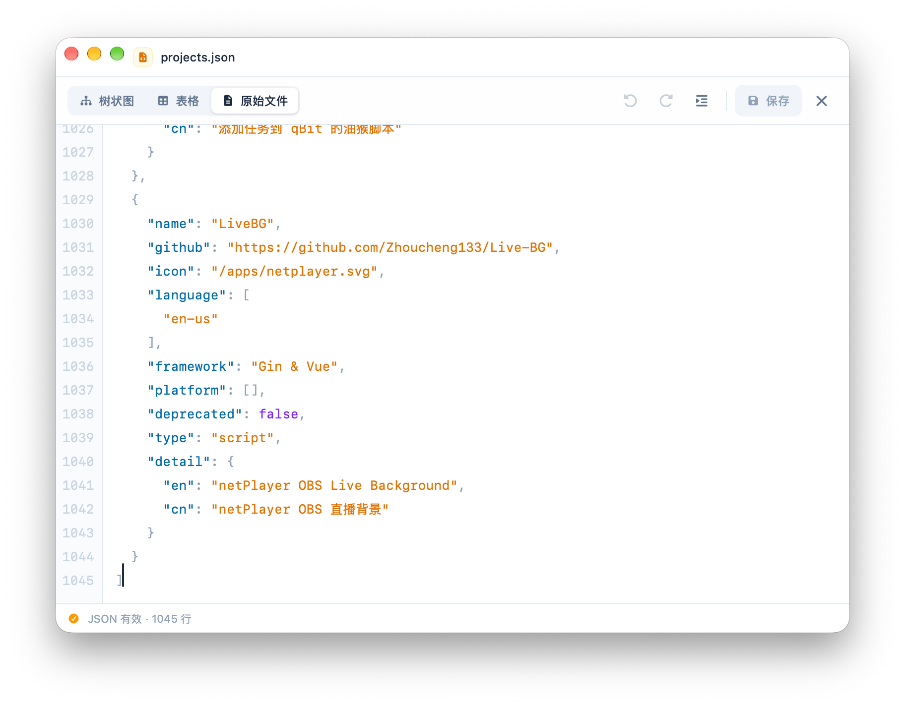

# JSON Editor

一个基于 Tauri 2 + Vue 3 的跨平台桌面 JSON 编辑器。打开或拖入 `.json` 文件后，可以用**树状图**、**表格**和**原始文件**三种方式编辑同一份内容，并安全地保存回本地。

> [!NOTE]
> 本项目主要由 **Vibe Coding** 完成，如果存在问题，欢迎提交 Issue 或 PR。

## 截图








## 功能特性

### 打开文件

- 支持系统文件选择器和拖拽打开，仅接受 `.json` 文件。
- 打开前会校验 JSON 格式，并展示文件大小、内容类型和结构摘要，例如「数组 · 12 项」「对象 · 5 个键」。
- 提供格式化后的内容预览，确认无误后再进入编辑。
- 文件大小上限为 10 MB，并会拒绝空文件和格式错误的文件。
- 在浏览器中直接运行 `vite` 时也可拖拽/选择文件预览，但保存功能仅在 Tauri 桌面端可用。

### 三种编辑模式

三种视图共享同一份文本内容，随时切换，不会丢失未保存的修改。

| 模式 | 适用场景 | 主要能力 |
| --- | --- | --- |
| **树状图** | 层级结构、嵌套对象 | 展开/折叠节点，点击键或值即可内联编辑；切换字段类型（字符串 / 数字 / 布尔 / null / 数组 / 对象）；为容器添加或删除字段 |
| **表格** | 对象数组、列表数据 | 单元格内联编辑与类型切换，布尔值一键切换；对象 / 数组单元格可直接输入 JSON（无法解析时提示并还原，`Esc` 取消）；拖拽调整行顺序；调整列宽（双击恢复默认）；重命名/添加/删除列；右键菜单插入或删除行列，并可跳转到树状图定位该节点 |
| **原始文件** | 精细修改、修复格式错误 | 带行号和 JSON 语法高亮，边输入边校验，实时提示错误位置；格式错误时可切回原始视图修复 |

### 编辑体验

- 全局撤销 / 重做，保留最近 200 次修改。
- 一键格式化（2 空格缩进）。
- 标题栏显示文件名、完整路径和未保存状态圆点。
- 保存按钮在内容未修改时自动禁用，保存过程中显示加载状态。
- 关闭文件或退出应用时，若有未保存修改会弹出确认提示。
- 表格视图对复杂值提供非法 JSON 高亮，解析失败时会提示错误并自动还原为原值。
- 表格单元格右键可「在树状图中定位」，自动展开并滚动到对应节点。
- 在任意视图中按 `⌘+F` / `Ctrl+F` 打开搜索框，支持匹配数量统计、上一个 / 下一个跳转和自动滚动定位；关闭后高亮随之消失。

### 保存安全

- 保存前在 Rust 端再次校验 JSON 格式，格式不合法会拒绝写入。
- 采用「先写临时文件、再原子替换」的方式保存，尽量避免写坏原文件。
- 保存成功后才清除未保存标记，并在底部显示轻量提示。

### 桌面端体验

- 无边框窗口，前端挂载完成后才显示，避免白屏闪烁。
- macOS 使用系统红绿灯按钮；Windows / Linux 使用自绘的最小化、最大化、关闭按钮。
- 支持窗口拖拽区域和自定义标题栏。

## 快速开始

### 环境要求

- [Bun](https://bun.sh/)（或 Node.js 20+，并相应调整命令）
- [Rust](https://www.rust-lang.org/tools/install)
- 对应平台的 Tauri 系统依赖，参考 [Tauri prerequisites](https://tauri.app/start/prerequisites/)

### 安装依赖

```bash
bun install
```

### 开发模式

```bash
bun run tauri dev
```

仅预览前端界面（保存等桌面能力不可用）：

```bash
bun run dev
```

### 构建

```bash
bun run tauri build
```

构建产物位于 `src-tauri/target/release/bundle/`。

## 快捷键

| 快捷键 | 功能 |
| --- | --- |
| `⌘ O` / `Ctrl O` | 打开文件 |
| `⌘ S` / `Ctrl S` | 保存 |
| `⌘ Z` / `Ctrl Z` | 撤销 |
| `⇧ ⌘ Z` / `Ctrl Y` | 重做 |
| `⌘ F` / `Ctrl F` | 在当前视图中搜索 |
| `Enter` / `⇧ Enter` | 搜索框中跳转到下一个 / 上一个匹配 |
| `Enter` | 确认内联编辑 / 表格单元格失焦 |
| `Esc` | 关闭搜索框 / 取消内联编辑（表格中会还原输入） / 在打开页移除已选文件 |